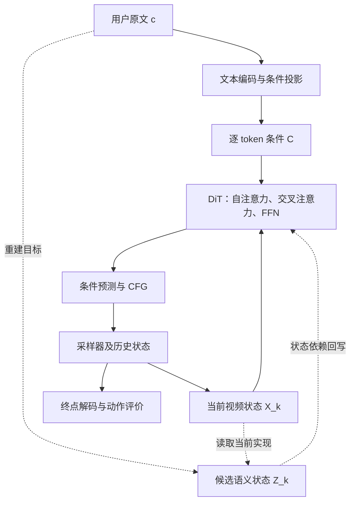

# 09 · 文本条件如何影响视频生成：计算图、偏差与改进机制

更新：2026-11-19。研究对象为公开的 **Wan2.1 T2V-1.3B**；资源边界为后训练。本文整理已发现的文献，并沿 Kling 报告的直接引用链补入 GRAN-TED 与 Semantic Routing。论文结果、源码事实、本次数学推导分别标注；没有运行视频模型或训练实验。

## 核心判断

文本条件的质量取决于一条完整路径：**指令中的任务相关区别能否被保留，能否送达合适的视频位置，能否在仍可改变动作的生成阶段产生正确响应，以及训练是否奖励了这种响应。**

Wan 的输入文本表示在采样过程中固定，但视频对文本的读取随当前视频状态而改变。因此，静态条件不等于静态作用。文字联合去噪是一种增加语义计算、辅助监督和显式反馈状态的构造；其价值需要定位到这条路径中的具体环节。

## 1. 统一计算图与坐标

### 1.1 Wan 基线

记原文为 $c$，文本编码为 $E$，条件投影为 $P$，视频 latent 为 $X_k$，采样步为 $k$：

$$
C=P(E(c)),\qquad
v_k^c=F_\theta(X_k,t_k,C),
$$
$$
v_k^{\mathrm{CFG}}=v_k^-+g(v_k^c-v_k^-),
\qquad
(X_{k+1},h_{k+1})=\mathcal S_k(X_k,h_k,v_k^{\mathrm{CFG}}).
$$

$h_k$ 保存多步采样器历史；负分支 $v_k^-$ 可使用固定 negative prompt，不能一概叫作无条件分支。最终视频是 VAE 对终点 latent 的解码。

实线是基线数据流；虚线是本项目拟研究的新增路径。训练损失改变参数，属于另一张反向计算图，不应与推理反馈混淆。

源码对应：Wan 1.3B 有 30 个 DiT blocks、宽度 1536、12 个注意力头；umT5 输出经过条件投影进入 cross-attention。视频产生 Query，文本产生 Key/Value。官方实现的自注意力和 FFN 由时间 embedding 调制；文本条件没有在每步产生新的文本状态。

- [固定版本 model.py][wan-model]
- [固定版本采样实现][wan-sampling]
- [公开 1.3B 配置][wan-config]

### 1.2 分开五种轴

| 符号 | 含义 | 所控制的问题 |
|---|---|---|
| $r$ | 文本编码器深度 | 取哪一层语义特征 |
| $\ell$ | DiT 深度 | 在生成网络哪个位置使用语义 |
| $k,t_k$ | 采样步、视频噪声水平 | 在去噪过程什么时候使用语义 |
| $f,p$ | latent 帧、帧内空间 patch | 语义应影响视频的何时何地 |
| $s$ | 文字腐化程度 | 原文字还有哪些不确定部分 |

Semantic Routing 的 time 指视频噪声时间，不是事件所在的帧时间。编码器层融合、DiT 层内图文交互、跨采样步文字更新也是三种不同操作。

### 1.3 文本如何成为视频更新

省略 batch/head 和当前层标签，保留决定语义的轴：

$$
Q_{kfp}=\mathrm{RMSNorm}(W_Q\mathrm{LN}(H_{kfp})),\quad
K_j=\mathrm{RMSNorm}(W_KC_j),\quad V_j=W_VC_j,
$$
$$
\Pi_{kfpj}=\mathrm{softmax}_j
\left(\frac{Q_{kfp}^{\mathsf T}K_j}{\sqrt{d_h}}\right),
\qquad
O_{kfp}=\sum_j\Pi_{kfpj}V_j.
$$

这是对 Wan cross-attention 的统一记法；输出还经过多头拼接、输出投影、残差和后续网络。官方 Q/K RMSNorm 在投影后、拆 head 前执行。**固定 $C$ 只使每层 K/V 固定，不使 Q、注意力权重或视频响应固定。**

## 2. 第一类：输入与监督文本——模型究竟被要求学习什么

共同图：

$$
V^\star\rightarrow \mathrm{Caption}(V^\star)\rightarrow
p_{\rm train}(V,c),
\qquad
c_{\rm user}\rightarrow R(c_{\rm user})\rightarrow E.
$$

| 文献 | 偏差位置 | 实际改进 | 证据范围 |
|---|---|---|---|
| [Wan 技术报告][wan] §3.3、§4.5 | 用户短提示与训练密集 caption 分布不同；动作描述不充分 | 组织多粒度 caption；LLM 扩写补足场景与自然动作，并匹配训练 caption 结构 | 是输入分布适配；文本在一次生成开始前确定 |
| [Kling 技术报告][kling] §3、§5 | caption 遗漏动作阶段、角色绑定或顺序；扩写偏离原意；只按语言质量挑选改写 | 稳定实体指称、细化事件关系；让 prompt enhancement 对齐训练描述；用生成视频的奖励优化改写器 | 工业系统的经验与下游评估；不能把全部工程建议当作独立因果实验 |

**分段总结。**视频中的运动关系如果没有进入训练 caption，就不会自动成为文本可控制的变量。例如把“先拿起杯子，再转身”压缩成“一个人在桌边”，会合并需要不同视频结果的请求。另一方面，同一指令换成训练中更常见的描述形式，可以降低有限模型的使用难度，但不增加原文之外的确定事实。扩写时要保留动作、主客体和先后约束。

## 3. 第二类：编码与适配——哪些区别能进入生成器

共同图：

$$
c\rightarrow\{E^{(r)}(c)\}_r
\rightarrow\mathrm{Fuse}
\rightarrow P
\rightarrow C.
$$

| 文献 | 改动的算子 | 偏差解释 | 实测与边界 |
|---|---|---|---|
| [Wan][wan] §4.7.2 | 比较 umT5、纯文本 LLM、VLM 及特征层 | 通用语言能力与可供 DiT 读取的表示质量不同 | 在 1.3B 框架的 T2I 训练消融中，umT5 优于 Qwen2.5/GLM 等；双向 refiner 没有反转；Qwen-VL 倒数第二层接近。不是所有新 LLM 都无效的结论 |
| [Kling][kling] §6 | 感知定向适配、多层逐 token 融合、稳定融合接口 | 单层特征遗漏不同粒度的语义；训练中的融合漂移增加适配困难 | 同 DiT/数据流/训练步的内部人评，指令遵循偏好比 1.04、1.11、1.14，均相对 Qwen baseline；指标是 $(G+S)/(S+B)$，不是准确率 |
| [GRAN-TED][gran] | 以生成相关 VQA 适配 Qwen3-VL；归一化多层加权；先学习融合再冻结 | 语言推理能力不保证 prefill hidden 适合作为条件；不稳定融合影响后续训练 | **直接后训练 Wan2.1-T2V-1.3B**。T2V GenAI 77.94→80.33，对照是 Qwen3-VL Norm-Avg，而非原始 umT5 Wan。整个 DiT 训练、文本投影重初始化，20k 步；不是已验证的小 adapter 配方 |
| [FLUX.3 Image Klein][flux3] | 8 层 Qwen3-VL token 特征拼接后投影；模态独立 blocks 后进入 joint blocks | 单层读取可能没有充分利用现成语言表征 | 图像架构实例；官方说明没有隔离“8 层”贡献。每步都输入干净文本，输出丢弃文本 token；层内图文交互不等于跨步文本扩散 |

GRAN-TED 的层融合可写作：

$$
C_j=\sum_r\alpha_r\,\mathrm{LN}(E^{(r)}_j(c)),
\quad \alpha=\mathrm{softmax}(w).
$$

这里保留逐 token 轴；其 sentence aggregator 主要用于表示评估，不应误写成生成器只接收一个 pooled 向量。

**分段总结。**“LLM 能回答关于先后顺序的问题”与“抽取的单层 hidden 经投影后能控制视频先后顺序”之间，还隔着特征选取、尺度、适配和下游读取。GRAN-TED 直接建立了 Wan1.3B 条件接口的后训练改善空间；它同时提醒我们，替换编码器需要重新建立生成器对条件的解释，不能假定更强 LLM 即插即用。

## 4. 第三类：语义调度与视觉规划——把语义变成可用的中间对象

### 4.1 按生成网络的位置配置语义

[Semantic Routing][routing] 使用：

$$
C_{t,\ell,j}=
\sum_r\alpha_{t,\ell,r}\,
\mathrm{LN}(E^{(r)}_j(c)).
$$

固定 backbone 与训练配置，比较单层、平均、静态可学习、仅依赖噪声时间、仅依赖 DiT 深度、同时依赖两者。其图像实验 GenEval：单层 64.54、归一化平均 66.51、Depth 67.07、Time 63.41、Joint 66.05。**在这个设置中，按噪声时间变化没有胜过静态多层平均。**

作者用训练插值状态与 CFG 实际轨迹不一致解释 Time 退化，并做时间平移实验；这是得到部分支持的机制解释，不是完整因果证明。它使用图像模型和大规模训练，不是 Wan 轻量后训练。对我们的启发是：噪声时间未必充分表征一个样本当前的语义完成度；依据当前视觉状态调度是另一个待验证构造。

### 4.2 先预测视觉语义，再生成像素

共同因子化：

$$
p(V\mid c)=\int p(V\mid S,c)p(S\mid c)\,dS.
$$

| 文献 | 计算图 | 改善针对什么偏差 | 边界 |
|---|---|---|---|
| [Bernini][bernini] | MLLM 迭代补全目标连续 ViT 特征 → 语义 connector → DiT；保留 T5 条件 | 文本/多模态理解到视觉实例之间缺少适合渲染的计划 | 完整模型为 Qwen2.5-VL-7B + Wan2.2-A14B；规划后渲染，不是每个视频去噪步重建文本。T2V VBench 84.64 对底座 84.79，主要说明保留能力；更强证据来自编辑和参考生成。公开 Bernini-R-1.3B 是 renderer-only |
| [X-Omni][xomni] | 文本 → AR 视觉语义 token → diffusion decoder → 图像奖励回到 AR 模型 | 自由生成 token 与 decoder 训练 token 不匹配，局部 token 预测好不等于最终图像好 | 图像工作；用下游结果奖励改善生成语义 token，无视频实证 |
| [TokenFlow][tokenflow] | 语义与像素双 codebook，共享索引 | 理解语义与精细重建需要不同粒度 | 图像 tokenizer，不是对 Wan 文本条件的直接实验 |
| [SemHiTok][semhitok] | 预训练语义 codebook 下建立像素子 codebook | 联合语义/像素损失相互牵制 | 图像表示的设计依据 |
| [Dual Stream Visual Tokenizer][dual] | 语义 token + 结构 token → 低分辨率指导与扩散重建 | 高层语义不足以确定细节结构 | 图像体系；不直接支持新视频码本是当前必要步骤 |

**分段总结。**这组方法研究的是条件对象的选择：从“句子的特征”转向“某个可视实现的计划”。它可以把语言规划与像素合成分开，但也引入计划误差和计划—渲染器分布差异。真实视频抽取的 $S^\star$ 可以用于训练与诊断；推理时必须使用可由原文或当前生成状态得到的 $S$，不能把真值计划当作公平的额外输入。

## 5. 第四类：时空路由与视觉动力学——正确语义在何时何地起作用

| 文献 | 实际干预位置 | 偏差机制 | 已建立的证据 |
|---|---|---|---|
| [TempoControl][tempo] | 从 cross-attention 构造时间 trace，按外部时间 mask 的目标反传，优化当前视频 latent | 概念存在但时间分配不对；增强时间响应也可能分散空间焦点 | Wan1.3B，冻结模型、推理干预；其动作时间控制任务 accuracy 19%→53%。额外使用时间 mask |
| [TSG: Temporal Specification Guidance][tsg] | 形式时序规范 → attention trace 分数 → logit bias → 额外受控前向 → 速度差修正 CFG | 概念出现没有保证顺序、持续和时段要求 | 包含 Wan1.3B；220 提示基准 SatAcc 15.9%→31.4%，imaging quality 69.25→67.39。需要结构化规范，增加推理开销 |
| [Why Do Video Diffusion Models Violate Physics?][physics] | 分析运动相关 heads；调整 self-attention 的空间 RoPE 频率；另有 LoRA 版本 | 语义注入后，跨帧候选可能被过强空间锚定锁到错误轨迹 | Wan1.3B 的直接干预证据；早期运动形成观察来自所分析案例，不是所有视频固定在前5步决定的定理 |

TSG 的统一表达：

$$
\widetilde\Pi=\mathrm{softmax}(L+B_\varphi),
\quad
v_{\rm TSG}=v_{\rm CFG}
+\lambda_{\rm TSG}(v_\varphi-v_c).
$$

其梯度用于 trace/规范评分和局部 attention bias，不反传整个视频 Transformer；TempoControl 则通过 attention 目标反向优化 latent。两者不应被写成同一种梯度方法。

### 值内容与位置分配是两个自由度

对于 $O=\Pi V$，局部一阶变化为：

$$
\delta O=\Pi\,\delta V+\delta\Pi\,V.
$$

前项改变送入的内容，后项改变内容送到哪里。固定当前 Q/K 的 value-only 注入满足：

$$
\Delta O_{fp}=\sum_j\Pi_{fpj}\Delta V_j.
$$

若两个帧位置的注意力行完全相同，它们得到的直接增量相同。因此，value-only 接口不能在该局部自行创造新的事件—帧分配。后续非线性、自注意力和不同视频状态仍可能把相同增量变成不同效果，这不是全网络不可能性定理。

一个时间敏感的候选接口是：

$$
\widetilde O_{kfp}=
\sum_j\mathrm{softmax}_j(L_{kfpj}+\beta_{kfj})
(V_j+\Delta V_{kj}).
$$

这只是本项目的算子构造，不是论文已证明有效的模块。按帧广播的 $\beta$ 处理时间选择性，还不自动解决多个主体之间的空间绑定。

**分段总结。**这组工作提供了最直接的判断：即使文字内容保持不变，改变它与帧、位置、注意力头和生成阶段之间的作用关系，仍能改善视频。注意力热图是观测线索；头消融、路由干预和最终视频变化才进一步支持因果作用。

## 6. 第五类：训练目标与辅助表示——模型为何没有学会正确使用条件

| 文献 | 训练/推理计算图 | 主要偏差 | 对当前研究的作用 |
|---|---|---|---|
| [SIFT][sift] | 从纯噪声运行少量高噪声生成步 → 动作类型判别监督；配合真实视频 MSE 与困难样本回放 | 真实加噪视频保留运动线索，单步重建可能绕开文本中的运动要求 | 直接检查并后训练 Wan1.3B；把监督放到模型自产运动。不能从单步 MSE 扰动诊断推出所有 SFT 无效 |
| [VideoREPA][videorepa] | 冻结视频 teacher → 真实视频时空 token 关系 → 监督 DiT hidden；推理去掉 teacher | 理解模型与生成模型表示任务不同；直接逐 token 特征约束可能扰乱生成表示 | 原论文是 CogVideoX-2B/5B。TRD 对齐帧内/跨帧 cosine 关系，保留表示自由度；不是 Wan 原始实证 |
| [VPT][vpt] | 视频、光流、实体角色图联合预测；训练使用独立噪声和辅助权重退火 | 光流不区分角色；辅助目标竞争容量；自产辅助误差循环影响视频 | Wan1.3B VideoPhy SA47.7→66.5、PC21.2→25.0，但 VBench Semantic65.43→64.86；物理改善不等于所有语义指标改善 |
| [Parasitic Co-Denoising][parasitic] | 冻结视频 hidden → 噪声依赖多层融合 → 3D 运动 decoder | 研究已有知识能否读出；没有建立视频纠偏机制 | Wan2.1-14B、19M decoder；没有向 host 回写，因此不构成视频改善证据 |

SIFT 的 1000 对视频—文本诊断中，正常、无关提示、打乱帧且同时打乱重建目标的单步 MSE 曲线接近。其准确含义是：**该诊断下的总体损失对这些变化不敏感。**打乱输入但保持原始目标则同时改变了输入—目标配对，不能把其更高误差单独归因于缺乏时间理解。

VideoREPA 的关系目标可以抽象为：

$$
\mathcal R(Z)_{ij}
=\frac{\langle Z_i,Z_j\rangle}{\|Z_i\|\|Z_j\|}.
$$

匹配 $\mathcal R(Z)$ 比要求两个网络使用相同特征坐标弱，例如共同正交换基不会改变 cosine 关系。这个不变性说明保留了哪些自由度；实验才说明这些自由度是否有利于生成。

VPT 的独立噪声是训练设计；推理不要求模态始终使用不同时间。其 cross-step auto-guidance 比较较早与最终**训练 checkpoint**，不是相邻扩散时间步。

**分段总结。**更好的表征、低重建损失、可读出的运动信息，都不自动等于更好的生成。监督必须改变实际生成路径，并对最终动作有用。辅助状态还会引入新的训练—推理差异：训练时是真值腐化，推理时是模型自己的预测；联合演化因此既可能纠错，也可能循环放大错误。

## 7. 第六类：文本重建与联合演化——与原想法最接近的工作

| 文献 | 是否重建文本 | 是否推理期跨步更新文本 | 是否已证明恢复原 prompt 改善视频 |
|---|---|---|---|
| [Uni-ViGU][univigu] | Stage1 恢复原 prompt，Stage2 学详细 caption；有 condition dropout | T2VT 模式联合更新视频和文本；普通 T2V 固定文本 | **直接视频近邻**。已实现联合演化；预览论文主要展示联合结果，未隔离同 prompt 重建轨迹的视频增益 |
| [FullFlow][fullflow] | 增加离散文本插入流；LoRA、文本头、独立模态时间 | 普通 T2I 固定 clean text；联合模式双状态演化 | 图像后训练可行性证据。FID/CMMD 相对冻结底座分布，衡量 prior preservation，不是超过原底座 |
| [Do DALL-E and Flamingo Understand Each Other?][dalle] | SD→BLIP 恢复原文本，也有反向图像重建；实际训练 selected projections | 无需每个采样步重建文本 | 图像上的重建监督证据；证明的是训练计算图的作用 |
| [Transfusion][transfusion] | 文本 AR loss 与连续图像 diffusion loss 共同训练 | 交替生成文本和完整图像；图像扩散期间前缀文本固定 | 多模态预训练架构，未实现当前图像与前缀文字同步去噪 |
| [MoT][mot] | 依具体生成配方决定 | 模态专属 attention/FFN/norm 本身不定义跨步更新 | 参数分工与效率依据，不是动态文本改善视频的实证 |

Uni-ViGU 公开推理实现同时保留干净条件与一个更新的离散文本状态。其正文的 embedding-flow 表达与公开离散 token sampler 不完全一致，复现时应分别处理；不能仅依据模型名称推定精确算法。[固定推理代码][univigu-code]

**分段总结。**需要分别识别三个增益来源：更合适的条件表示、文字重建带来的训练监督、推理时根据当前视频进行反馈。前两个可以在部署时固定文本；第三个需要实际跨步的状态依赖计算。已有文献证明相关组件可实现，尚未把这三种作用合在一起证明为 Wan1.3B 的视频增量。

## 8. 数学抽象：从文献分类得到可推理的统一对象

以下为本次推导，不是某一篇论文已经证明的机制。

### 8.1 任务相关区别：表示保留了什么

设条件接口为 $\Phi(c)$。若两个提示满足：

$$
\Phi(c_1)=\Phi(c_2),
$$

且全部其他输入、随机机制相同，则只依赖这条条件接口的生成器不能区分二者。若任务要求两者的视频动作不同，这就是表示错误合并。

但 $\|\Phi(c_1)-\Phi(c_2)\|$ 小并不自动说明响应小。对可微的局部连续条件变化：

$$
\delta v\approx J_{v,C}\delta C.
$$

需要区分：

1. 接口没有保留目标语义；
2. 接口有区别，但落在下游弱敏感方向；
3. 下游有响应，但改变了背景/风格而非目标动作。

只用文本 probe、embedding 距离或 attention 大小，不能区分后两种。

### 8.2 局部改变如何影响最终动作

把视频和多步求解器历史组成充分的数值状态 $a_k=(X_k,h_k)$，控制量为 $u_k$。固定参数和其他随机性，写：

$$
a_{k+1}=F_k(a_k,u_k),\qquad y=\psi(a_K).
$$

$\psi$ 包含解码和关注的动作/角色/顺序读出。在可微局部定义：

$$
A_k=D_aF_k,\qquad B_k=D_uF_k,
$$
$$
\delta y\approx
\sum_k
\underbrace{D\psi(a_K)A_{K-1}\cdots A_{k+1}B_k}_{G_k}
\delta u_k.
$$

$G_k$ 才描述“这一步写入的语义，最后怎样改变视频动作”。局部变化可以被后续传播压低、转向或放大；较大的局部扰动也未必改善目标。对不可微的人评指标使用有限干预和完整生成结果，不伪造 Jacobian。

这里把 $\delta u_k$ 当作外部注入。当 $u_k$ 本身由反馈策略产生时，需要把策略导数纳入状态转移，或把语义状态并入 $a_k$，再使用同一表达。

### 8.3 固定原文重建为什么仍可能有用

若完整文本 $c$ 已知，$Z_s=q_s(c,\eta)$ 只由文本和独立噪声构造，$\eta$ 与视频训练随机变量独立，则：

$$
\mathbb E[v^\star\mid X_t,c,Z_s]
=\mathbb E[v^\star\mid X_t,c].
$$

这限定于理想统计信息；不意味着有限 Wan 的两种实现等效。实际模型看到的是压缩后的条件，受容量、接口和训练限制。文字重建可能：

| 作用 | 改变什么 | 不必依赖什么 |
|---|---|---|
| 条件重表示 | 将原文组织成更可用的事件/角色状态 | 不必推理时持续更新 |
| 辅助监督 | 使共享生成表示区分动作、角色和顺序 | 不必最终生成不同的文本 |
| 视觉反馈 | 根据当前已实现的视频修正后续条件 | 不必以离散文字作为唯一状态 |

独立文本噪声本身没有新增任务信息；外部预训练模型带来的计算与先验、增加的状态和学习信号仍可能改善有限模型。这些机制需要分别评价。

### 8.4 联合演化应保存“目标”和“当前实现”的区别

一种待验证的分工：

$$
Z_{k+1}=D_\phi(Z_k,R(X_k),t_k,s_k),
\quad
u_k=W_\omega(c,Z_{k+1},t_k),
$$
$$
a_{k+1}=F_k(a_k,u_k).
$$

原文 $c$ 是目标；视觉 reader 观测实际状态；writer 根据二者的差异回写。最终把文本恢复为原句，与产生有用的中间反馈相容。

用于检验反馈解释的功能判据：

- **能观察目标相关错误。**固定提示后改变实际动作或事件次序，reader 应有相应差异。只读出 prompt 意图，不能证明读出了当前视频。完整原文直接或经条件化 hidden 泄漏给 reader 都可形成捷径；detach 不会移除信息。
- **能产生有方向的干预。**目标差异要落入 $G_k$ 可作用的方向，最终减少动作错误，而不只是增加某个 token 的 attention。
- **观察与干预时段相容。**视频足以提供证据时，轨迹还需要可改变；不要求文本与视频使用同一噪声进度。

无记忆反馈 $u_k=\pi(c,a_k,t_k)$ 可以复合进一个新的固定条件预测器；它并不证明静态输入网络原则上无法表示该映射。新增路径的研究价值在于有限 Wan 是否更容易通过后训练学到并执行这种计算。显式语义记忆若不能由当前视频和求解器状态恢复，则进一步扩充了状态。

上面的 $G_k$ 仅是一阶局部工具：非零作用不保证纠错，零作用不排除有限幅度或高阶效应。如果关注平滑任务损失 $\mathcal L(y)$，小干预还需使 $\langle\nabla_y\mathcal L,G_k\delta u_k\rangle<0$ 才在局部指向改善。

一个确切的读出反例：若逐帧独立编码后无位置平均，

$$
R(X)=\frac1F\sum_f r(X_f),
$$

则对任意帧置换 $P$，$R(PX)=R(X)$，无法辨认事件顺序。先进行时序编码再池化不受这一反例直接排除。

**研究落点。**值得验证的是：用原文本重建训练出能区分当前动作/角色/顺序的状态，并通过时间与空间选择性接口纠偏。显式文本扩散是这种状态的一种实现；它应与多层静态条件、只有重建辅助监督、无文字重建的同结构反馈分别比较。

## 9. 一个精确的回归误差分解，以及它不能说明什么

在固定噪声水平、固定真实加噪训练分布下，设：

$$
W=(X_t,c),\quad U=(X_t,\Phi(c)),\quad
Y=v^\star,\quad
m_W=\mathbb E[Y\mid W],\quad
m_U=\mathbb E[Y\mid U].
$$

若变量平方可积，$\Phi$ 与预测器 $f$ 固定，$U$ 是 $W$ 的确定函数，则条件期望正交性给出：

$$
\mathbb E\|Y-f(U)\|^2
=
\mathbb E\|Y-m_W\|^2
+\mathbb E\|m_W-m_U\|^2
+\mathbb E\|m_U-f(U)\|^2.
$$

三个交叉项为零：$Y-m_W$ 与任何 $W$-可测量正交；$m_W-m_U$ 与任何 $U$-可测量正交。

三项分别是：

1. 完整条件下的回归不可约方差；
2. 条件接口压缩带来的预测信息损失；
3. 实际下游预测器到其 Bayes 预测器的误差，合并容量、优化、样本估计和条件使用等因素。

第一项不是视频质量下限：即使这项为正，最优均值速度场仍可能生成正确条件分布。第三项也不能仅凭分解定位为 cross-attention 故障。这个分解只帮助区分“信息丢了”和“模型没有用好”；最终视频质量仍需经过上一节的轨迹传播和任务读出判断。

## 10. 证据顺序与当前结论

| 希望支持的命题 | 目前最直接的文献 | 仍需保留的限定 |
|---|---|---|
| Wan1.3B 文本接口存在后训练改善空间 | GRAN-TED | 比较的是适配后的 MLLM 条件方案，且训练整个 DiT |
| 不改变原文也能改善视频时序 | TempoControl、TSG | 提供额外时序条件；改善有画质/开销取舍 |
| 偏差可能发生于文字注入之后 | Physics/RoPE 分析 | 以具体干预和分析案例为范围 |
| 直接奖励生成动作能改变条件使用 | SIFT | 动作类型与评估范围有限，不能外推为完整物理理解 |
| 联合辅助状态可以帮助生成 | VPT | 同时带来容量竞争和误差循环，指标不一定一致上升 |
| 文字恢复和视频联合演化可实现 | Uni-ViGU | 尚未隔离原 prompt 重建过程的视频增量 |
| 理解/生成可用较少新增参数连接 | FullFlow、Parasitic Co-Denoising | 分别是图像先验保留与只读运动生成，不能直接证明视频收益 |

本轮文献支持的核心研究问题是：

> 原文重建能否产生比静态条件更有用、能观察当前生成偏差的语义状态，并在 Wan1.3B 仍可控制动作的阶段，通过适合的时空接口改善最终视频？

这把“文本是否也扩散”落实到了可观察的状态、实际写入的算子和视频侧的效果。当前证据支持组件可行性与若干直接改进路径；尚未组成这条完整因果链。

## 来源索引与阅读定位

| 文献 | 本次使用的定位 | 性质 |
|---|---|---|
| Wan | §3.3、4.5、4.7.2；官方模型/采样/配置代码 | 基线与工业消融 |
| Kling | §3、5、6；Table14 | 工业报告 |
| GRAN-TED | §3.3–3.5；Table6；Appendix C.1 | 直接 Wan1.3B 后训练 |
| Semantic Routing | §3；Table1；§5.2 | 受控图像实验 |
| FLUX.3 | 官方 Diffusers 说明：From prompt to tokens、Two stages、Denoising loop | 图像架构说明，无单模块因果消融 |
| Bernini | §2、4、6.5；官方 Bernini-R 说明 | 视频规划/编辑 |
| X-Omni | §3.1–3.2 | 图像 AR+diffusion |
| TokenFlow | 摘要、方法 | 图像表示 |
| SemHiTok | 正式 proceedings 摘要 | 图像表示，仅使用摘要支持的机制 |
| Dual Stream | 正式 proceedings 摘要 | 图像表示，仅使用摘要支持的机制 |
| TempoControl | §3–5、Table1 | 视频推理控制 |
| TSG | 原 PDF pp.4–6，方法图与 Table1 | 视频推理控制，预印本 |
| Physics | 作者项目、原文和上轮 head/算子审计 | 视频动力学干预 |
| SIFT | 原 PDF pp.5–7、14 | 视频后训练 |
| VideoREPA | §3.2–3.4、§4 | CogVideoX 后训练 |
| VPT | 作者项目、原 PDF pp.3–6 | 视频辅助模态后训练 |
| Parasitic Co-Denoising | 原摘要、PDF pp.4–7 | 冻结 14B 的只读 decoder |
| Uni-ViGU | §3–4；固定版本推理代码 | 联合视频/文本，preview |
| FullFlow | 作者项目方法、normal/joint modes、prior preservation 定义 | 图像后训练 |
| DalleFlamingo | 作者项目、官方 train.py 的梯度路径 | 图像 cycle finetuning |
| Transfusion | §3 Attention/Inference | 图文预训练 |
| MoT | 正式摘要、官方 README | 多模态架构 |

[wan]: https://arxiv.org/html/2503.20314v1
[wan-model]: https://github.com/Wan-Video/Wan2.1/blob/9737cba9c1c3c4d04b33fcad41c111989865d315/wan/modules/model.py
[wan-sampling]: https://github.com/Wan-Video/Wan2.1/blob/9737cba9c1c3c4d04b33fcad41c111989865d315/wan/text2video.py
[wan-config]: https://huggingface.co/Wan-AI/Wan2.1-T2V-1.3B/blob/main/config.json
[kling]: https://arxiv.org/html/2611.04916v1
[gran]: https://arxiv.org/html/2512.15560v1
[routing]: https://arxiv.org/html/2602.03510v1
[flux3]: https://huggingface.co/blog/flux-3
[bernini]: https://arxiv.org/html/2605.22344v1
[xomni]: https://arxiv.org/html/2507.22058v1
[tokenflow]: https://arxiv.org/html/2412.03069v1
[semhitok]: https://proceedings.iclr.cc/paper_files/paper/2026/hash/49ffa271264808cf500ea528ed8ec9b3-Abstract-Conference.html
[dual]: https://www.ijcai.org/proceedings/2025/167
[tempo]: https://arxiv.org/html/2510.02226v1
[tsg]: https://arxiv.org/pdf/2610.20822
[physics]: https://siriuslala.github.io/physics/
[sift]: https://arxiv.org/pdf/2606.27741v3
[videorepa]: https://arxiv.org/html/2505.23656v1
[vpt]: https://tom-zgt.github.io/VPT/
[parasitic]: https://arxiv.org/abs/2610.03047
[univigu]: https://arxiv.org/html/2604.08121v1
[univigu-code]: https://github.com/Fr0zenCrane/Uni-ViGU/blob/b73244f3a71143a3960ba9814f3686f50a778620/inference_unified_wan.py
[fullflow]: https://ericbill21.github.io/fullflow/
[dalle]: https://dalleflamingo.github.io/
[transfusion]: https://arxiv.org/html/2408.11039v1
[mot]: https://arxiv.org/abs/2411.04996
